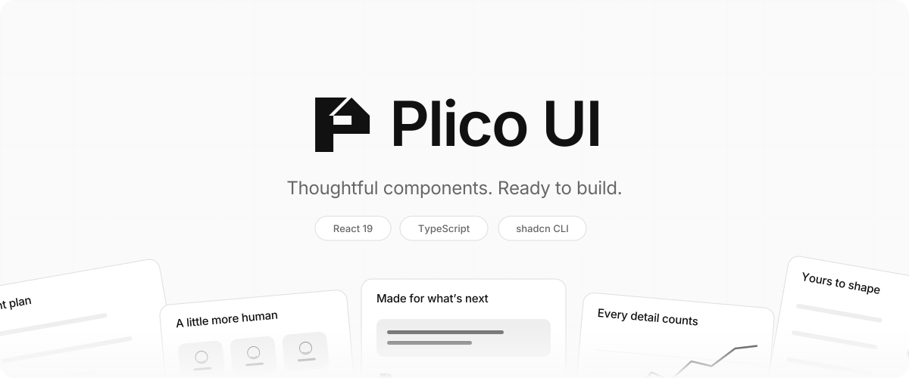
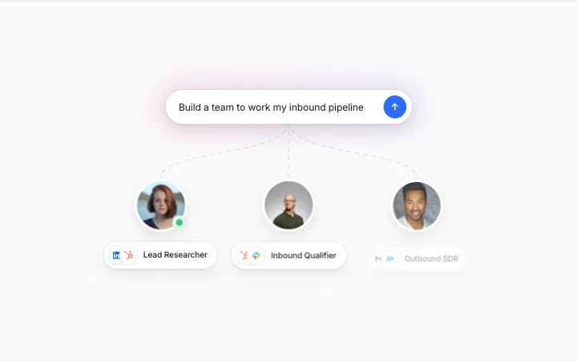
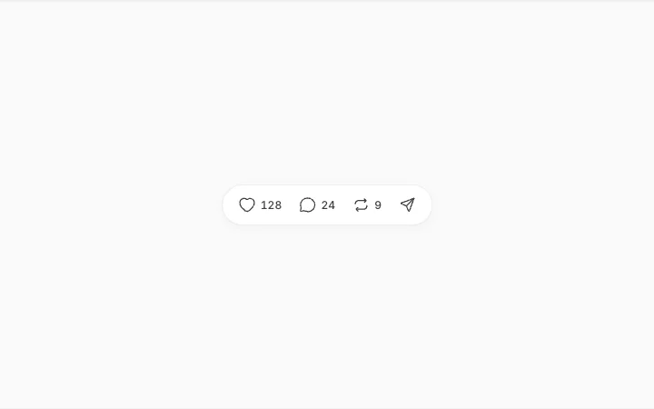
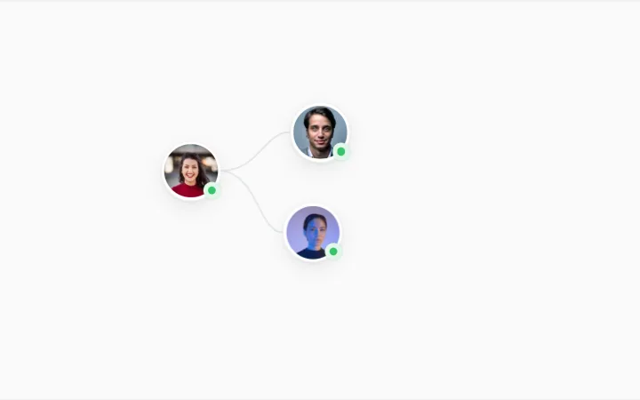
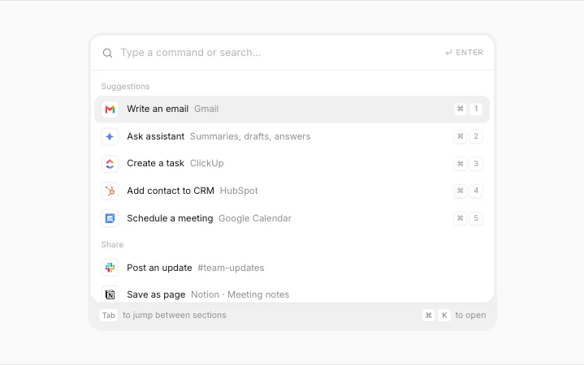
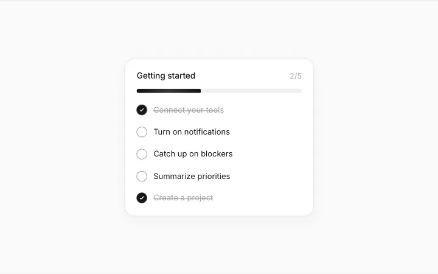
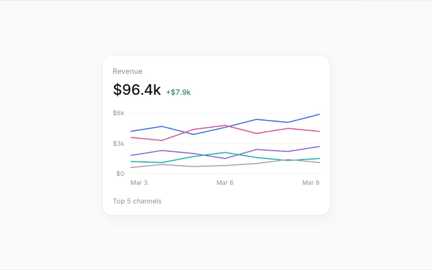
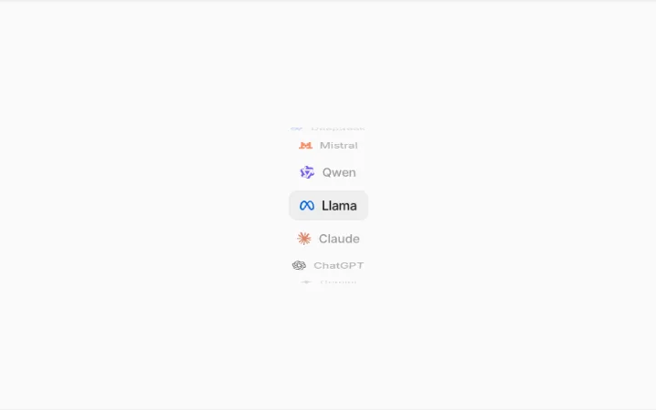
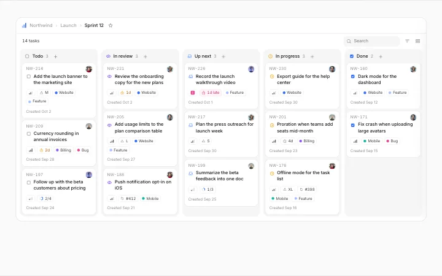

<p align="center">
  <a href="https://plico-ui.vercel.app">
    <picture>
      <source media="(prefers-color-scheme: dark)" srcset="./public/brand/plico-hero.svg">
      <source media="(prefers-color-scheme: light)" srcset="./public/brand/plico-hero-light.svg">
      
    </picture>
  </a>
</p>

<p align="center">
  <a href="./LICENSE"></a>
  <a href="https://plico-ui.vercel.app/docs/installation"></a>
  
  
  
</p>

<p align="center">
  <a href="https://plico-ui.vercel.app"><b>Website</b></a>
  &nbsp;·&nbsp;
  <a href="https://plico-ui.vercel.app/components"><b>Browse components</b></a>
  &nbsp;·&nbsp;
  <a href="https://plico-ui.vercel.app/docs"><b>Docs</b></a>
  &nbsp;·&nbsp;
  <a href="#install"><b>Install</b></a>
  &nbsp;·&nbsp;
  <a href="#local-development"><b>Develop</b></a>
</p>

Plico UI is a library of React components, blocks, illustrations, screens, and motion effects for AI products and modern SaaS apps. Every item is **one `.tsx` file with its styles inside**: no Tailwind setup or animation library required. Install it with the shadcn CLI or copy the source into your project.

## Showcase

A few favorites from the [Plico UI catalog](https://plico-ui.vercel.app/components). Every item below is included in this repository.

<table>
<tr>
<td width="50%" valign="top">
<a href="https://plico-ui.vercel.app/illustrations/agent-team"><picture>
<source media="(prefers-color-scheme: dark)" srcset="./public/assets/previews/dark/agent-team.webp">

</picture></a>
<br><a href="https://plico-ui.vercel.app/illustrations/agent-team"><b>Agent Team</b></a><br>
<sub>One prompt, three agents, and a shared set of tools.</sub>
</td>
<td width="50%" valign="top">
<a href="https://plico-ui.vercel.app/components/reaction-bar"><picture>
<source media="(prefers-color-scheme: dark)" srcset="./public/assets/previews/dark/reaction-bar.webp">

</picture></a>
<br><a href="https://plico-ui.vercel.app/components/reaction-bar"><b>Reaction Bar</b></a><br>
<sub>A compact action bar with animated reactions and counts.</sub>
</td>
</tr>
<tr>
<td width="50%" valign="top">
<a href="https://plico-ui.vercel.app/illustrations/team-invite"><picture>
<source media="(prefers-color-scheme: dark)" srcset="./public/assets/previews/dark/team-invite.webp">

</picture></a>
<br><a href="https://plico-ui.vercel.app/illustrations/team-invite"><b>Team Invite</b></a><br>
<sub>Connected teammates and an invitation that comes to life.</sub>
</td>
<td width="50%" valign="top">
<a href="https://plico-ui.vercel.app/components/command-menu"><picture>
<source media="(prefers-color-scheme: dark)" srcset="./public/assets/previews/dark/command-menu.webp">

</picture></a>
<br><a href="https://plico-ui.vercel.app/components/command-menu"><b>Command Menu</b></a><br>
<sub>Search tools and actions from one keyboard-friendly field.</sub>
</td>
</tr>
<tr>
<td width="50%" valign="top">
<a href="https://plico-ui.vercel.app/components/progress-tracker"><picture>
<source media="(prefers-color-scheme: dark)" srcset="./public/assets/previews/dark/progress-tracker.webp">

</picture></a>
<br><a href="https://plico-ui.vercel.app/components/progress-tracker"><b>Progress Tracker</b></a><br>
<sub>An onboarding checklist with animated progress and completion.</sub>
</td>
<td width="50%" valign="top">
<a href="https://plico-ui.vercel.app/components/kpi-chart"><picture>
<source media="(prefers-color-scheme: dark)" srcset="./public/assets/previews/dark/kpi-chart.webp">

</picture></a>
<br><a href="https://plico-ui.vercel.app/components/kpi-chart"><b>KPI Chart</b></a><br>
<sub>A metric card with a multi-line chart and pointer-following tooltip.</sub>
</td>
</tr>
<tr>
<td width="50%" valign="top">
<a href="https://plico-ui.vercel.app/illustrations/model-wheel"><picture>
<source media="(prefers-color-scheme: dark)" srcset="./public/assets/previews/dark/model-wheel.webp">

</picture></a>
<br><a href="https://plico-ui.vercel.app/illustrations/model-wheel"><b>Model Wheel</b></a><br>
<sub>Model names on a turning drum with a soft selected state.</sub>
</td>
<td width="50%" valign="top">
<a href="https://plico-ui.vercel.app/blocks/task-board"><picture>
<source media="(prefers-color-scheme: dark)" srcset="./public/assets/previews/dark/task-board.webp">

</picture></a>
<br><a href="https://plico-ui.vercel.app/blocks/task-board"><b>Task Board</b></a><br>
<sub>A task board with priorities, assignees, and agent activity.</sub>
</td>
</tr>
</table>

## Contents

- [Why Plico UI](#why-plico-ui)
- [Install](#install)
- [Usage](#usage)
- [Use it with AI tools](#use-it-with-ai-tools)
- [Components](#components)
- [Blocks](#blocks)
- [Illustrations](#illustrations)
- [Screens](#screens)
- [Motion](#motion)
- [Local development](#local-development)
- [Contributing](#contributing)
- [License](#license)

## Why Plico UI

- **One file each.** Standalone TypeScript components with styles and assets included, ready to edit in your own codebase.
- **Motion with purpose.** Rolling numbers, soft reveals, smooth state changes, and responsive interactions.
- **Two component styles.** Classic and Clean variants for all 51 components, with separate registry names.
- **Dark mode built in.** Components support an ancestor with the class `dark` or `data-theme="dark"`.
- **Complete product surfaces.** Compose smaller components, use a ready-made block, or start from a full application screen.
- **Ready for agents.** Browse structured documentation through MCP or the machine-readable catalog.

## Install

### Requirements

- React 19 and React DOM 19
- A React project such as Next.js or Vite, with TypeScript recommended
- A configured shadcn components alias when installing with the CLI

### With the shadcn CLI

Initialize shadcn in the receiving project if needed, then run the command from an item's page. Choose your package manager:

```sh
# pnpm
pnpm dlx shadcn@latest add https://plico-ui.vercel.app/r/reaction-bar.json

# npm
npx shadcn@latest add https://plico-ui.vercel.app/r/reaction-bar.json

# yarn
yarn dlx shadcn@latest add https://plico-ui.vercel.app/r/reaction-bar.json

# bun
bunx --bun shadcn@latest add https://plico-ui.vercel.app/r/reaction-bar.json
```

The component lands at `components/plico/reaction-bar.tsx` under your configured shadcn components alias. A shared notice is installed separately at `licenses/plico-ui.txt`.

Prefer short names? Register the namespace once in `components.json`, keeping the project's existing settings:

```json
{
  "registries": {
    "@plico": "https://plico-ui.vercel.app/r/{name}.json"
  }
}
```

```sh
pnpm dlx shadcn@latest add @plico/reaction-bar
```

For a protected deployment, configure the registry's automation header as described in [registry and agent access](docs/runbooks/registry.md).

### Copy and paste

Open the item's `.tsx` file in [`src/components/plico/`](src/components/plico), copy it into your project, and import it. The Code tab on each documentation page shows the same source. Keep the shared license notice with redistributed components.

## Usage

```tsx
"use client";

import ReactionBar from "@/components/plico/reaction-bar";

export function PostActions() {
  return (
    <ReactionBar
      reactions={{
        like: { count: 128, active: true },
        comment: { count: 12 },
      }}
      onReact={(key, state) => {
        console.log(key, state.count, state.active);
      }}
    />
  );
}
```

The default export is the reusable component. Named exports include `Component`, `Demo`, descriptive component aliases, and applicable helpers and types. Full application screens also expose `FullScreen`.

Props, examples, and interaction notes live on each item's page, such as [Reaction Bar](https://plico-ui.vercel.app/components/reaction-bar). Existing version 0.1 installations should follow the [component migration guide](docs/runbooks/migrate-v0.2.md).

## Use it with AI tools

Plico UI provides a read-only MCP server so agents can search the catalog, read component details, and get installation commands:

```sh
claude mcp add --transport http plico-ui https://plico-ui.vercel.app/mcp
```

For other MCP clients, configure the HTTP endpoint:

```json
{
  "mcpServers": {
    "plico-ui": {
      "url": "https://plico-ui.vercel.app/mcp"
    }
  }
}
```

You can also point an assistant at [`llms.txt`](https://plico-ui.vercel.app/llms.txt). Item pages include prompts for AI coding tools. See [registry and agent access](docs/runbooks/registry.md) for available tools and protected-host configuration.

## Components

51 components in Classic and Clean styles (102 installable variants).

| Name                                                                                                    | What it is                                                                                                                                                                                                            | Install                                                        |
| ------------------------------------------------------------------------------------------------------- | --------------------------------------------------------------------------------------------------------------------------------------------------------------------------------------------------------------------- | -------------------------------------------------------------- |
| [Agent Inbox](https://plico-ui.vercel.app/components/agent-inbox)                                       | All your background agent tasks in one calm list – live clocks and status tags, filter tabs with rolling counts, rows that unfold to the last steps with Approve, Reject, Retry or Open, and glide to their new place | `pnpm dlx shadcn@latest add @plico/agent-inbox`                |
| [Agent Inbox (Clean)](https://plico-ui.vercel.app/components/agent-inbox?style=clean)                   | All your background agent tasks in one calm list – live clocks and status tags, filter tabs with rolling counts, rows that unfold to the last steps with Approve, Reject, Retry or Open, and glide to their new place | `pnpm dlx shadcn@latest add @plico/agent-inbox-clean`          |
| [Agent Lanes](https://plico-ui.vercel.app/components/agent-lanes)                                       | Where every agent is right now – a live timeline with a lane per agent, tasks growing into “now”, hand-offs drawn between agents and approvals right on the block                                                     | `pnpm dlx shadcn@latest add @plico/agent-lanes`                |
| [Agent Lanes (Clean)](https://plico-ui.vercel.app/components/agent-lanes?style=clean)                   | Where every agent is right now – a live timeline with a lane per agent, tasks growing into “now”, hand-offs drawn between agents and approvals right on the block                                                     | `pnpm dlx shadcn@latest add @plico/agent-lanes-clean`          |
| [Agent Plan](https://plico-ui.vercel.app/components/agent-plan)                                         | An agent's step-by-step plan to review before it runs – rename, drag to reorder, remove or add steps, then watch each one run with live timers and retry from a failed step                                           | `pnpm dlx shadcn@latest add @plico/agent-plan`                 |
| [Agent Plan (Clean)](https://plico-ui.vercel.app/components/agent-plan?style=clean)                     | An agent's step-by-step plan to review before it runs – rename, drag to reorder, remove or add steps, then watch each one run with live timers and retry from a failed step                                           | `pnpm dlx shadcn@latest add @plico/agent-plan-clean`           |
| [Agent Steering](https://plico-ui.vercel.app/components/agent-steering)                                 | Steer an agent while it works – queue a note for the next step and watch it glide into the plan when the agent picks it up, or interrupt right away                                                                   | `pnpm dlx shadcn@latest add @plico/agent-steering`             |
| [Agent Steering (Clean)](https://plico-ui.vercel.app/components/agent-steering?style=clean)             | Steer an agent while it works – queue a note for the next step and watch it glide into the plan when the agent picks it up, or interrupt right away                                                                   | `pnpm dlx shadcn@latest add @plico/agent-steering-clean`       |
| [AI Answer](https://plico-ui.vercel.app/components/ai-answer)                                           | Streamed answer with source cards, citation chips that preview their source, copy, regenerate, feedback and follow-ups                                                                                                | `pnpm dlx shadcn@latest add @plico/ai-answer`                  |
| [AI Answer (Clean)](https://plico-ui.vercel.app/components/ai-answer?style=clean)                       | Streamed answer with source cards, citation chips that preview their source, copy, regenerate, feedback and follow-ups                                                                                                | `pnpm dlx shadcn@latest add @plico/ai-answer-clean`            |
| [Approval Card](https://plico-ui.vercel.app/components/approval-card)                                   | An agent asks before it acts – risk badge, preview, Approve and Deny with shortcuts, a pausing countdown, and a smooth morph into a resolved row                                                                      | `pnpm dlx shadcn@latest add @plico/approval-card`              |
| [Approval Card (Clean)](https://plico-ui.vercel.app/components/approval-card?style=clean)               | An agent asks before it acts – risk badge, preview, Approve and Deny with shortcuts, a pausing countdown, and a smooth morph into a resolved row                                                                      | `pnpm dlx shadcn@latest add @plico/approval-card-clean`        |
| [Autonomy Dial](https://plico-ui.vercel.app/components/autonomy-dial)                                   | How much an agent may do on its own – a three-stop dial, and its real actions gliding between “Runs on its own” and “Asks you first”, with a lock for what always asks                                                | `pnpm dlx shadcn@latest add @plico/autonomy-dial`              |
| [Autonomy Dial (Clean)](https://plico-ui.vercel.app/components/autonomy-dial?style=clean)               | How much an agent may do on its own – a three-stop dial, and its real actions gliding between “Runs on its own” and “Asks you first”, with a lock for what always asks                                                | `pnpm dlx shadcn@latest add @plico/autonomy-dial-clean`        |
| [Billing Schedule](https://plico-ui.vercel.app/components/billing-schedule)                             | Build a billing phase – start date, duration, products with repeats and timing, discount, minimum and live totals                                                                                                     | `pnpm dlx shadcn@latest add @plico/billing-schedule`           |
| [Billing Schedule (Clean)](https://plico-ui.vercel.app/components/billing-schedule?style=clean)         | Build a billing phase – start date, duration, products with repeats and timing, discount, minimum and live totals                                                                                                     | `pnpm dlx shadcn@latest add @plico/billing-schedule-clean`     |
| [Breakdown Chart](https://plico-ui.vercel.app/components/breakdown-chart)                               | Stacked bar chart with measure, slice and segment pickers, a hover breakdown and a linked table                                                                                                                       | `pnpm dlx shadcn@latest add @plico/breakdown-chart`            |
| [Breakdown Chart (Clean)](https://plico-ui.vercel.app/components/breakdown-chart?style=clean)           | Stacked bar chart with measure, slice and segment pickers, a hover breakdown and a linked table                                                                                                                       | `pnpm dlx shadcn@latest add @plico/breakdown-chart-clean`      |
| [Button](https://plico-ui.vercel.app/components/button)                                                 | Primary, secondary, ghost and destructive buttons with icons, sizes and a shimmering loading state                                                                                                                    | `pnpm dlx shadcn@latest add @plico/button`                     |
| [Button (Clean)](https://plico-ui.vercel.app/components/button?style=clean)                             | Primary, secondary, ghost and destructive buttons with icons, sizes and a shimmering loading state                                                                                                                    | `pnpm dlx shadcn@latest add @plico/button-clean`               |
| [Change Summary](https://plico-ui.vercel.app/components/change-summary)                                 | What moved since last time – one metric per row with a colored trend                                                                                                                                                  | `pnpm dlx shadcn@latest add @plico/change-summary`             |
| [Change Summary (Clean)](https://plico-ui.vercel.app/components/change-summary?style=clean)             | What moved since last time – one metric per row with a colored trend                                                                                                                                                  | `pnpm dlx shadcn@latest add @plico/change-summary-clean`       |
| [Chat Composer](https://plico-ui.vercel.app/components/chat-composer)                                   | Prompt composer with model picker, voice input, app connections and approval request                                                                                                                                  | `pnpm dlx shadcn@latest add @plico/chat-composer`              |
| [Chat Composer (Clean)](https://plico-ui.vercel.app/components/chat-composer?style=clean)               | Prompt composer with model picker, voice input, app connections and approval request                                                                                                                                  | `pnpm dlx shadcn@latest add @plico/chat-composer-clean`        |
| [Cited Answer](https://plico-ui.vercel.app/components/cited-answer)                                     | An AI answer wired to its sources – point at a citation to light up its sentence and source, click to unfold the quoted passage with the matching words marked                                                        | `pnpm dlx shadcn@latest add @plico/cited-answer`               |
| [Cited Answer (Clean)](https://plico-ui.vercel.app/components/cited-answer?style=clean)                 | An AI answer wired to its sources – point at a citation to light up its sentence and source, click to unfold the quoted passage with the matching words marked                                                        | `pnpm dlx shadcn@latest add @plico/cited-answer-clean`         |
| [Combobox](https://plico-ui.vercel.app/components/combobox)                                             | Pick one or many from a searchable, grouped list – chips with avatars, highlighted matches, create-on-the-fly and full keyboard support                                                                               | `pnpm dlx shadcn@latest add @plico/combobox`                   |
| [Combobox (Clean)](https://plico-ui.vercel.app/components/combobox?style=clean)                         | Pick one or many from a searchable, grouped list – chips with avatars, highlighted matches, create-on-the-fly and full keyboard support                                                                               | `pnpm dlx shadcn@latest add @plico/combobox-clean`             |
| [Command Menu](https://plico-ui.vercel.app/components/command-menu)                                     | Search and run anything from one field – tool actions with logos and ⌘1–⌘5, everyday commands with icons                                                                                                              | `pnpm dlx shadcn@latest add @plico/command-menu`               |
| [Command Menu (Clean)](https://plico-ui.vercel.app/components/command-menu?style=clean)                 | Search and run anything from one field – tool actions with logos and ⌘1–⌘5, everyday commands with icons                                                                                                              | `pnpm dlx shadcn@latest add @plico/command-menu-clean`         |
| [Comment Thread](https://plico-ui.vercel.app/components/comment-thread)                                 | One comment with replies – an assistant reports what it did, folds open details and answers @mentions                                                                                                                 | `pnpm dlx shadcn@latest add @plico/comment-thread`             |
| [Comment Thread (Clean)](https://plico-ui.vercel.app/components/comment-thread?style=clean)             | One comment with replies – an assistant reports what it did, folds open details and answers @mentions                                                                                                                 | `pnpm dlx shadcn@latest add @plico/comment-thread-clean`       |
| [Comments Panel](https://plico-ui.vercel.app/components/comments-panel)                                 | Comment feed with filters, runnable /edit commands, resolve and a composer                                                                                                                                            | `pnpm dlx shadcn@latest add @plico/comments-panel`             |
| [Comments Panel (Clean)](https://plico-ui.vercel.app/components/comments-panel?style=clean)             | Comment feed with filters, runnable /edit commands, resolve and a composer                                                                                                                                            | `pnpm dlx shadcn@latest add @plico/comments-panel-clean`       |
| [Compact Breakdown](https://plico-ui.vercel.app/components/compact-breakdown)                           | A total split into its parts in one small card – numbers roll, the bar glides and the ranked rows trade places when the period changes                                                                                | `pnpm dlx shadcn@latest add @plico/compact-breakdown`          |
| [Compact Breakdown (Clean)](https://plico-ui.vercel.app/components/compact-breakdown?style=clean)       | A total split into its parts in one small card – numbers roll, the bar glides and the ranked rows trade places when the period changes                                                                                | `pnpm dlx shadcn@latest add @plico/compact-breakdown-clean`    |
| [Context Window](https://plico-ui.vercel.app/components/context-window)                                 | What fills the model's context, as a field of cells – hover a part to light it up, remove files, and compact the conversation while its cells shimmer and clear                                                       | `pnpm dlx shadcn@latest add @plico/context-window`             |
| [Context Window (Clean)](https://plico-ui.vercel.app/components/context-window?style=clean)             | What fills the model's context, as a field of cells – hover a part to light it up, remove files, and compact the conversation while its cells shimmer and clear                                                       | `pnpm dlx shadcn@latest add @plico/context-window-clean`       |
| [Data Table](https://plico-ui.vercel.app/components/data-table)                                         | Spreadsheet-style table: select cells and ranges, edit in place, copy and paste, undo and sort                                                                                                                        | `pnpm dlx shadcn@latest add @plico/data-table`                 |
| [Data Table (Clean)](https://plico-ui.vercel.app/components/data-table?style=clean)                     | Spreadsheet-style table: select cells and ranges, edit in place, copy and paste, undo and sort                                                                                                                        | `pnpm dlx shadcn@latest add @plico/data-table-clean`           |
| [Date Range Picker](https://plico-ui.vercel.app/components/date-range-picker)                           | Presets and two calendars with a hover preview, comparison with the previous period or year, full keyboard control                                                                                                    | `pnpm dlx shadcn@latest add @plico/date-range-picker`          |
| [Date Range Picker (Clean)](https://plico-ui.vercel.app/components/date-range-picker?style=clean)       | Presets and two calendars with a hover preview, comparison with the previous period or year, full keyboard control                                                                                                    | `pnpm dlx shadcn@latest add @plico/date-range-picker-clean`    |
| [Decision Inbox](https://plico-ui.vercel.app/components/decision-inbox)                                 | Open decisions with two quick answers each – answered ones confirm and fold away                                                                                                                                      | `pnpm dlx shadcn@latest add @plico/decision-inbox`             |
| [Decision Inbox (Clean)](https://plico-ui.vercel.app/components/decision-inbox?style=clean)             | Open decisions with two quick answers each – answered ones confirm and fold away                                                                                                                                      | `pnpm dlx shadcn@latest add @plico/decision-inbox-clean`       |
| [Dropzone](https://plico-ui.vercel.app/components/dropzone)                                             | Drag files in and watch them upload – fanning documents, colored type badges, progress with time left, errors with retry                                                                                              | `pnpm dlx shadcn@latest add @plico/dropzone`                   |
| [Dropzone (Clean)](https://plico-ui.vercel.app/components/dropzone?style=clean)                         | Drag files in and watch them upload – fanning documents, colored type badges, progress with time left, errors with retry                                                                                              | `pnpm dlx shadcn@latest add @plico/dropzone-clean`             |
| [Email Draft](https://plico-ui.vercel.app/components/email-draft)                                       | Agent-written email for review – switch recipient and tone, edit inline, remove the attachment, send or discard with undo                                                                                             | `pnpm dlx shadcn@latest add @plico/email-draft`                |
| [Email Draft (Clean)](https://plico-ui.vercel.app/components/email-draft?style=clean)                   | Agent-written email for review – switch recipient and tone, edit inline, remove the attachment, send or discard with undo                                                                                             | `pnpm dlx shadcn@latest add @plico/email-draft-clean`          |
| [Experiment Card](https://plico-ui.vercel.app/components/experiment-card)                               | An A/B test in two lines that quietly unfolds on hover – variants linked to a tiny chart, a metric switch with rolling numbers, and a winner you pick with a click                                                    | `pnpm dlx shadcn@latest add @plico/experiment-card`            |
| [Experiment Card (Clean)](https://plico-ui.vercel.app/components/experiment-card?style=clean)           | An A/B test in two lines that quietly unfolds on hover – variants linked to a tiny chart, a metric switch with rolling numbers, and a winner you pick with a click                                                    | `pnpm dlx shadcn@latest add @plico/experiment-card-clean`      |
| [Filter Menu](https://plico-ui.vercel.app/components/filter-menu)                                       | Grouped filters with removable chips, collapsible checkbox groups, Clear all and full keyboard control                                                                                                                | `pnpm dlx shadcn@latest add @plico/filter-menu`                |
| [Filter Menu (Clean)](https://plico-ui.vercel.app/components/filter-menu?style=clean)                   | Grouped filters with removable chips, collapsible checkbox groups, Clear all and full keyboard control                                                                                                                | `pnpm dlx shadcn@latest add @plico/filter-menu-clean`          |
| [Inline Diff](https://plico-ui.vercel.app/components/inline-diff)                                       | AI edits to prose shown inline – struck and added words you accept or reject one by one, with keys, a popover and undo                                                                                                | `pnpm dlx shadcn@latest add @plico/inline-diff`                |
| [Inline Diff (Clean)](https://plico-ui.vercel.app/components/inline-diff?style=clean)                   | AI edits to prose shown inline – struck and added words you accept or reject one by one, with keys, a popover and undo                                                                                                | `pnpm dlx shadcn@latest add @plico/inline-diff-clean`          |
| [Integration Picker](https://plico-ui.vercel.app/components/integration-picker)                         | Integrations page of a command menu – search, a list of services and the picked one with its connection on two tiles                                                                                                  | `pnpm dlx shadcn@latest add @plico/integration-picker`         |
| [Integration Picker (Clean)](https://plico-ui.vercel.app/components/integration-picker?style=clean)     | Integrations page of a command menu – search, a list of services and the picked one with its connection on two tiles                                                                                                  | `pnpm dlx shadcn@latest add @plico/integration-picker-clean`   |
| [Integration Settings](https://plico-ui.vercel.app/components/integration-settings)                     | Settings card for a connected service – on/off switch, API key, validated site address, time zone and a save bar                                                                                                      | `pnpm dlx shadcn@latest add @plico/integration-settings`       |
| [Integration Settings (Clean)](https://plico-ui.vercel.app/components/integration-settings?style=clean) | Settings card for a connected service – on/off switch, API key, validated site address, time zone and a save bar                                                                                                      | `pnpm dlx shadcn@latest add @plico/integration-settings-clean` |
| [KPI Chart](https://plico-ui.vercel.app/components/kpi-chart)                                           | Metric card with a multi-line chart and a tooltip that follows the pointer                                                                                                                                            | `pnpm dlx shadcn@latest add @plico/kpi-chart`                  |
| [KPI Chart (Clean)](https://plico-ui.vercel.app/components/kpi-chart?style=clean)                       | Metric card with a multi-line chart and a tooltip that follows the pointer                                                                                                                                            | `pnpm dlx shadcn@latest add @plico/kpi-chart-clean`            |
| [Memory Panel](https://plico-ui.vercel.app/components/memory-panel)                                     | What the assistant remembers about you, grouped and editable – a master switch, category filters, and on every memory edit in place, pause or forget with Undo on the tray                                            | `pnpm dlx shadcn@latest add @plico/memory-panel`               |
| [Memory Panel (Clean)](https://plico-ui.vercel.app/components/memory-panel?style=clean)                 | What the assistant remembers about you, grouped and editable – a master switch, category filters, and on every memory edit in place, pause or forget with Undo on the tray                                            | `pnpm dlx shadcn@latest add @plico/memory-panel-clean`         |
| [Message Actions](https://plico-ui.vercel.app/components/message-actions)                               | The quiet bar under an AI message – copy turns into a check, regenerate spins and unfolds a version switcher, thumbs pop and ask why, read aloud becomes a tiny equalizer                                             | `pnpm dlx shadcn@latest add @plico/message-actions`            |
| [Message Actions (Clean)](https://plico-ui.vercel.app/components/message-actions?style=clean)           | The quiet bar under an AI message – copy turns into a check, regenerate spins and unfolds a version switcher, thumbs pop and ask why, read aloud becomes a tiny equalizer                                             | `pnpm dlx shadcn@latest add @plico/message-actions-clean`      |
| [Model Picker](https://plico-ui.vercel.app/components/model-picker)                                     | The model menu of an AI chat – point at a model and its speed, quality and cost bars fill, switch on extended thinking and its effort unfolds, while the tray rolls the first-token time and price                    | `pnpm dlx shadcn@latest add @plico/model-picker`               |
| [Model Picker (Clean)](https://plico-ui.vercel.app/components/model-picker?style=clean)                 | The model menu of an AI chat – point at a model and its speed, quality and cost bars fill, switch on extended thinking and its effort unfolds, while the tray rolls the first-token time and price                    | `pnpm dlx shadcn@latest add @plico/model-picker-clean`         |
| [Notification Stack](https://plico-ui.vercel.app/components/notification-stack)                         | Notice cards stacked behind each other – dismiss the front one to reveal the next                                                                                                                                     | `pnpm dlx shadcn@latest add @plico/notification-stack`         |
| [Notification Stack (Clean)](https://plico-ui.vercel.app/components/notification-stack?style=clean)     | Notice cards stacked behind each other – dismiss the front one to reveal the next                                                                                                                                     | `pnpm dlx shadcn@latest add @plico/notification-stack-clean`   |
| [OTP Input](https://plico-ui.vercel.app/components/otp-input)                                           | The verification code field done right – a gliding focus ring, paste and SMS autofill, a calm shake on errors and a morph into Verified                                                                               | `pnpm dlx shadcn@latest add @plico/otp-input`                  |
| [OTP Input (Clean)](https://plico-ui.vercel.app/components/otp-input?style=clean)                       | The verification code field done right – a gliding focus ring, paste and SMS autofill, a calm shake on errors and a morph into Verified                                                                               | `pnpm dlx shadcn@latest add @plico/otp-input-clean`            |
| [Profile Menu](https://plico-ui.vercel.app/components/profile-menu)                                     | Account card with the signed-in user, menu actions and profile setup progress                                                                                                                                         | `pnpm dlx shadcn@latest add @plico/profile-menu`               |
| [Profile Menu (Clean)](https://plico-ui.vercel.app/components/profile-menu?style=clean)                 | Account card with the signed-in user, menu actions and profile setup progress                                                                                                                                         | `pnpm dlx shadcn@latest add @plico/profile-menu-clean`         |
| [Progress Tracker](https://plico-ui.vercel.app/components/progress-tracker)                             | Onboarding checklist with an animated progress bar, ticks that draw themselves and auto play                                                                                                                          | `pnpm dlx shadcn@latest add @plico/progress-tracker`           |
| [Progress Tracker (Clean)](https://plico-ui.vercel.app/components/progress-tracker?style=clean)         | Onboarding checklist with an animated progress bar, ticks that draw themselves and auto play                                                                                                                          | `pnpm dlx shadcn@latest add @plico/progress-tracker-clean`     |
| [Project Card](https://plico-ui.vercel.app/components/project-card)                                     | A two-line project summary that quietly unfolds on hover – a progress ring with one segment per subtask, a people filter and a status picker, all linked by hover                                                     | `pnpm dlx shadcn@latest add @plico/project-card`               |
| [Project Card (Clean)](https://plico-ui.vercel.app/components/project-card?style=clean)                 | A two-line project summary that quietly unfolds on hover – a progress ring with one segment per subtask, a people filter and a status picker, all linked by hover                                                     | `pnpm dlx shadcn@latest add @plico/project-card-clean`         |
| [Prompt Library](https://plico-ui.vercel.app/components/prompt-library)                                 | Saved prompt templates with variables – type straight into the sentence, watch the finished prompt assemble below, and use it once every variable is filled                                                           | `pnpm dlx shadcn@latest add @plico/prompt-library`             |
| [Prompt Library (Clean)](https://plico-ui.vercel.app/components/prompt-library?style=clean)             | Saved prompt templates with variables – type straight into the sentence, watch the finished prompt assemble below, and use it once every variable is filled                                                           | `pnpm dlx shadcn@latest add @plico/prompt-library-clean`       |
| [Reaction Bar](https://plico-ui.vercel.app/components/reaction-bar)                                     | Like, comment, repost and share in one pill – icons pop and fill, counts roll in digit by digit                                                                                                                       | `pnpm dlx shadcn@latest add @plico/reaction-bar`               |
| [Reaction Bar (Clean)](https://plico-ui.vercel.app/components/reaction-bar?style=clean)                 | Like, comment, repost and share in one pill – icons pop and fill, counts roll in digit by digit                                                                                                                       | `pnpm dlx shadcn@latest add @plico/reaction-bar-clean`         |
| [Segmented Control](https://plico-ui.vercel.app/components/segmented-control)                           | Switch between two to six options – a raised pill or underline that glides, stretches a little and can be dragged across, with icons, counts and badges                                                               | `pnpm dlx shadcn@latest add @plico/segmented-control`          |
| [Segmented Control (Clean)](https://plico-ui.vercel.app/components/segmented-control?style=clean)       | Switch between two to six options – a raised pill or underline that glides, stretches a little and can be dragged across, with icons, counts and badges                                                               | `pnpm dlx shadcn@latest add @plico/segmented-control-clean`    |
| [Setup Guide](https://plico-ui.vercel.app/components/setup-guide)                                       | Onboarding panel with a progress bar and collapsible task groups that strike through when done                                                                                                                        | `pnpm dlx shadcn@latest add @plico/setup-guide`                |
| [Setup Guide (Clean)](https://plico-ui.vercel.app/components/setup-guide?style=clean)                   | Onboarding panel with a progress bar and collapsible task groups that strike through when done                                                                                                                        | `pnpm dlx shadcn@latest add @plico/setup-guide-clean`          |
| [Smart Recommendation](https://plico-ui.vercel.app/components/smart-recommendation)                     | Suggestion card with a confidence signal, alternatives to switch to and accept with undo                                                                                                                              | `pnpm dlx shadcn@latest add @plico/smart-recommendation`       |
| [Smart Recommendation (Clean)](https://plico-ui.vercel.app/components/smart-recommendation?style=clean) | Suggestion card with a confidence signal, alternatives to switch to and accept with undo                                                                                                                              | `pnpm dlx shadcn@latest add @plico/smart-recommendation-clean` |
| [Stepper Form](https://plico-ui.vercel.app/components/stepper-form)                                     | A multi-step flow for onboarding and setup – steps that fill and check off, sliding steps, a card that morphs to each step, inline validation and a success state                                                     | `pnpm dlx shadcn@latest add @plico/stepper-form`               |
| [Stepper Form (Clean)](https://plico-ui.vercel.app/components/stepper-form?style=clean)                 | A multi-step flow for onboarding and setup – steps that fill and check off, sliding steps, a card that morphs to each step, inline validation and a success state                                                     | `pnpm dlx shadcn@latest add @plico/stepper-form-clean`         |
| [Thinking Loader](https://plico-ui.vercel.app/components/thinking-loader)                               | A small working pill for AI replies – an eight-ray spinner and a shimmering label that rolls through phases and settles on a check                                                                                    | `pnpm dlx shadcn@latest add @plico/thinking-loader`            |
| [Thinking Loader (Clean)](https://plico-ui.vercel.app/components/thinking-loader?style=clean)           | A small working pill for AI replies – an eight-ray spinner and a shimmering label that rolls through phases and settles on a check                                                                                    | `pnpm dlx shadcn@latest add @plico/thinking-loader-clean`      |
| [Thinking State](https://plico-ui.vercel.app/components/thinking-state)                                 | AI working panel with a live timer, searched sources and thinking steps that appear one by one                                                                                                                        | `pnpm dlx shadcn@latest add @plico/thinking-state`             |
| [Thinking State (Clean)](https://plico-ui.vercel.app/components/thinking-state?style=clean)             | AI working panel with a live timer, searched sources and thinking steps that appear one by one                                                                                                                        | `pnpm dlx shadcn@latest add @plico/thinking-state-clean`       |
| [Tips Panel](https://plico-ui.vercel.app/components/tips-panel)                                         | Grid of short tips with one action each – taken tips turn into a done state                                                                                                                                           | `pnpm dlx shadcn@latest add @plico/tips-panel`                 |
| [Tips Panel (Clean)](https://plico-ui.vercel.app/components/tips-panel?style=clean)                     | Grid of short tips with one action each – taken tips turn into a done state                                                                                                                                           | `pnpm dlx shadcn@latest add @plico/tips-panel-clean`           |
| [Toaster](https://plico-ui.vercel.app/components/toaster)                                               | Calm toasts from anywhere – a stack that fans out on hover, promise toasts that morph from spinner to check, swipe to dismiss                                                                                         | `pnpm dlx shadcn@latest add @plico/toaster`                    |
| [Toaster (Clean)](https://plico-ui.vercel.app/components/toaster?style=clean)                           | Calm toasts from anywhere – a stack that fans out on hover, promise toasts that morph from spinner to check, swipe to dismiss                                                                                         | `pnpm dlx shadcn@latest add @plico/toaster-clean`              |
| [Tool Call Card](https://plico-ui.vercel.app/components/tool-call-card)                                 | An agent's tool call in one line – live timer, status and summary, folds open to highlighted arguments and result with copy, retry on errors and a group that sums them up                                            | `pnpm dlx shadcn@latest add @plico/tool-call-card`             |
| [Tool Call Card (Clean)](https://plico-ui.vercel.app/components/tool-call-card?style=clean)             | An agent's tool call in one line – live timer, status and summary, folds open to highlighted arguments and result with copy, retry on errors and a group that sums them up                                            | `pnpm dlx shadcn@latest add @plico/tool-call-card-clean`       |
| [Usage Meter](https://plico-ui.vercel.app/components/usage-meter)                                       | Plan usage and AI credits – a stacked credits meter by category, daily sparkline, limits and a button that speaks up near the limit                                                                                   | `pnpm dlx shadcn@latest add @plico/usage-meter`                |
| [Usage Meter (Clean)](https://plico-ui.vercel.app/components/usage-meter?style=clean)                   | Plan usage and AI credits – a stacked credits meter by category, daily sparkline, limits and a button that speaks up near the limit                                                                                   | `pnpm dlx shadcn@latest add @plico/usage-meter-clean`          |
| [Writing Assistant](https://plico-ui.vercel.app/components/writing-assistant)                           | AI chat card with a soft gradient glow, suggestions, streaming replies and live voice dictation                                                                                                                       | `pnpm dlx shadcn@latest add @plico/writing-assistant`          |
| [Writing Assistant (Clean)](https://plico-ui.vercel.app/components/writing-assistant?style=clean)       | AI chat card with a soft gradient glow, suggestions, streaming replies and live voice dictation                                                                                                                       | `pnpm dlx shadcn@latest add @plico/writing-assistant-clean`    |

## Blocks

11 blocks.

| Name                                                                       | What it is                                                                                                                                                                                         | Install                                               |
| -------------------------------------------------------------------------- | -------------------------------------------------------------------------------------------------------------------------------------------------------------------------------------------------- | ----------------------------------------------------- |
| [Agent Gallery](https://plico-ui.vercel.app/blocks/agent-gallery)          | Slim gradient panels with one open product screen in the middle – pick a panel and it glides open                                                                                                  | `pnpm dlx shadcn@latest add @plico/agent-gallery`     |
| [AI Workspace](https://plico-ui.vercel.app/blocks/ai-workspace)            | Complete assistant app – sidebar, welcome, streaming chat and projects, built on the Chat Composer                                                                                                 | `pnpm dlx shadcn@latest add @plico/ai-workspace`      |
| [App Directory](https://plico-ui.vercel.app/blocks/app-directory)          | Browse, search and connect integrations – categories, filters and app cards with a connect flow                                                                                                    | `pnpm dlx shadcn@latest add @plico/app-directory`     |
| [Client Context](https://plico-ui.vercel.app/blocks/client-context)        | A client workspace with live numbers and a shared context timeline – switch clients, search, filter and add notes or files                                                                         | `pnpm dlx shadcn@latest add @plico/client-context`    |
| [Invoice & Credit Note](https://plico-ui.vercel.app/blocks/invoice-credit) | An invoice and its credit note stacked like paper – switch between them, pick lines to credit, adjust amounts and issue                                                                            | `pnpm dlx shadcn@latest add @plico/invoice-credit`    |
| [KPI Board](https://plico-ui.vercel.app/blocks/kpi-board)                  | The top of a dashboard – three trend cards, an overview chart that compares this period with the last, and a focus card; hover shows any day's value and every number rolls when the range changes | `pnpm dlx shadcn@latest add @plico/kpi-board`         |
| [Logo Marquee](https://plico-ui.vercel.app/blocks/logo-marquee)            | The endless “Trusted by” strip – a seamless loop that eases to a stop on hover, scrubs with inertia and lifts the hovered logo to colour                                                           | `pnpm dlx shadcn@latest add @plico/logo-marquee`      |
| [Metrics Dashboard](https://plico-ui.vercel.app/blocks/metrics-dashboard)  | Sales overview – KPI cards pick the metric, one chart switches between dotted line and bars, with top products and channels                                                                        | `pnpm dlx shadcn@latest add @plico/metrics-dashboard` |
| [Pricing Plans](https://plico-ui.vercel.app/blocks/pricing-plans)          | Pricing section with a monthly / yearly switch, three plan cards and collapsible details                                                                                                           | `pnpm dlx shadcn@latest add @plico/pricing-plans`     |
| [Task Board](https://plico-ui.vercel.app/blocks/task-board)                | Kanban board with drag and drop, quick add, a detail panel, search, label filters and a compact view                                                                                               | `pnpm dlx shadcn@latest add @plico/task-board`        |
| [Testimonial Wall](https://plico-ui.vercel.app/blocks/testimonial-wall)    | The landing-page wall of quotes – columns that scroll endlessly in opposite directions, ease to a stop on hover and scrub with inertia                                                             | `pnpm dlx shadcn@latest add @plico/testimonial-wall`  |

## Illustrations

24 illustrations.

| Name                                                                             | What it is                                                                                                                                                                     | Install                                               |
| -------------------------------------------------------------------------------- | ------------------------------------------------------------------------------------------------------------------------------------------------------------------------------ | ----------------------------------------------------- |
| [Agent Team](https://plico-ui.vercel.app/illustrations/agent-team)               | A prompt types itself and branches out into three agents, each with a role and overlapping tool logos                                                                          | `pnpm dlx shadcn@latest add @plico/agent-team`        |
| [Cover Flow](https://plico-ui.vercel.app/illustrations/cover-flow)               | Browse covers in 3D – drag, flick or scrub the row, it springs to the nearest cover; images drift in their frames over a soft reflection                                       | `pnpm dlx shadcn@latest add @plico/cover-flow`        |
| [Empty Calendar](https://plico-ui.vercel.app/illustrations/empty-calendar)       | Stack of calendar cards marked empty, fanning out on hover                                                                                                                     | `pnpm dlx shadcn@latest add @plico/empty-calendar`    |
| [Enrichment Orbit](https://plico-ui.vercel.app/illustrations/enrichment-orbit)   | Grok tile inside two rings with comets and data nodes orbiting around it                                                                                                       | `pnpm dlx shadcn@latest add @plico/enrichment-orbit`  |
| [Frost Cloud](https://plico-ui.vercel.app/illustrations/frost-cloud)             | A frosted white cloud with eyes cut out of it, on a red-orange or blue sky – it floats, turns to look around, blinks, follows the pointer and bounces with a wink when clicked | `pnpm dlx shadcn@latest add @plico/frost-cloud`       |
| [Ghosted Chat](https://plico-ui.vercel.app/illustrations/ghosted-chat)           | Unanswered chat messages marked as read, with a thumbs-down reply on hover                                                                                                     | `pnpm dlx shadcn@latest add @plico/ghosted-chat`      |
| [Glass Folder](https://plico-ui.vercel.app/illustrations/glass-folder)           | Glassy blue folder with documents behind a frosted pocket that tips open on hover                                                                                              | `pnpm dlx shadcn@latest add @plico/glass-folder`      |
| [Glow Cloud](https://plico-ui.vercel.app/illustrations/glow-cloud)               | A glowing cloud with eyes in blue or red-orange – it floats, turns to look around, blinks, follows the pointer and bounces with a wink when clicked                            | `pnpm dlx shadcn@latest add @plico/glow-cloud`        |
| [Glow Keyboard](https://plico-ui.vercel.app/illustrations/glow-keyboard)         | AI chat input that types itself over a glass keyboard – every key press sends a wave up the gradient floor                                                                     | `pnpm dlx shadcn@latest add @plico/glow-keyboard`     |
| [Integration Beam](https://plico-ui.vercel.app/illustrations/integration-beam)   | Your product between the tools it connects – light pulses flow along curved beams, hover to focus a tool, click to pause it                                                    | `pnpm dlx shadcn@latest add @plico/integration-beam`  |
| [Integration Flow](https://plico-ui.vercel.app/illustrations/integration-flow)   | Integration pills rotating along a dashed arc, each beaming its data into a central analysis hub                                                                               | `pnpm dlx shadcn@latest add @plico/integration-flow`  |
| [Integration Grid](https://plico-ui.vercel.app/illustrations/integration-grid)   | Honeycomb-like wall of integration logos around a bright centre tile with your product mark, fading out toward the edges                                                       | `pnpm dlx shadcn@latest add @plico/integration-grid`  |
| [Layer Stack](https://plico-ui.vercel.app/illustrations/layer-stack)             | Isometric stack of five layers with a list beside it – the chosen entry lifts its layer out in color                                                                           | `pnpm dlx shadcn@latest add @plico/layer-stack`       |
| [Lead Sourcing](https://plico-ui.vercel.app/illustrations/lead-sourcing)         | ChatGPT tile linked to Gmail and Grok, with a shine running along the connection                                                                                               | `pnpm dlx shadcn@latest add @plico/lead-sourcing`     |
| [Logo Cluster](https://plico-ui.vercel.app/illustrations/logo-cluster)           | Your mark on a white disc in the middle – company logos bounce out of it and settle around it                                                                                  | `pnpm dlx shadcn@latest add @plico/logo-cluster`      |
| [Model Wheel](https://plico-ui.vercel.app/illustrations/model-wheel)             | AI model names on a turning drum – the rows bend away at the edges and each model lands on a soft gray fill                                                                    | `pnpm dlx shadcn@latest add @plico/model-wheel`       |
| [Outreach Branches](https://plico-ui.vercel.app/illustrations/outreach-branches) | Lines branching out to Gmail, Slack and Notion with colored pulses flowing down                                                                                                | `pnpm dlx shadcn@latest add @plico/outreach-branches` |
| [Project Flow](https://plico-ui.vercel.app/illustrations/project-flow)           | Animated scene of a client task branching into subtasks, notes and assigned roles                                                                                              | `pnpm dlx shadcn@latest add @plico/project-flow`      |
| [DACH Region](https://plico-ui.vercel.app/illustrations/region-dach)             | DACH map with fading neighbours and a pastel band along the border, switchable to the US, China, India, Brazil or Japan                                                        | `pnpm dlx shadcn@latest add @plico/region-dach`       |
| [Side Folder](https://plico-ui.vercel.app/illustrations/side-folder)             | Glassy blue folder on its side, documents sliding out to the right as the pocket swings open on hover                                                                          | `pnpm dlx shadcn@latest add @plico/side-folder`       |
| [Tab Overload](https://plico-ui.vercel.app/illustrations/tab-overload)           | Overlapping browser windows where the highlight follows the hovered tab                                                                                                        | `pnpm dlx shadcn@latest add @plico/tab-overload`      |
| [Team Invite](https://plico-ui.vercel.app/illustrations/team-invite)             | Connected teammates – a cursor drags a new one into the empty slot, the line turns solid and they go online                                                                    | `pnpm dlx shadcn@latest add @plico/team-invite`       |
| [Voice Orb](https://plico-ui.vercel.app/illustrations/voice-orb)                 | The face of a voice assistant – a sphere of dots that breathes, catches sound, collapses into a spinning ring while thinking and ripples when it speaks                        | `pnpm dlx shadcn@latest add @plico/voice-orb`         |
| [World Map Continental](https://plico-ui.vercel.app/illustrations/world-map)     | World map with one highlighted continent and a pastel band along its coastline, switchable between all six                                                                     | `pnpm dlx shadcn@latest add @plico/world-map`         |

## Screens

12 screens. Each includes a named `FullScreen` export for a complete route.

| Name                                                                       | What it is                                                                                                                             | Install                                              |
| -------------------------------------------------------------------------- | -------------------------------------------------------------------------------------------------------------------------------------- | ---------------------------------------------------- |
| [Agent Chat](https://plico-ui.vercel.app/screens/agent-chat)               | Chat with an orchestrating agent, the agents at work, and a brief to fill in beside it                                                 | `pnpm dlx shadcn@latest add @plico/agent-chat`       |
| [Agent Run](https://plico-ui.vercel.app/screens/agent-run)                 | One autonomous agent run: the plan ticking through its steps, the tool calls, an approval it waits on and the draft it wrote           | `pnpm dlx shadcn@latest add @plico/agent-run`        |
| [Analytics](https://plico-ui.vercel.app/screens/analytics)                 | Revenue dashboard: key figures, revenue by channel, breakdown, top products and weekly trends                                          | `pnpm dlx shadcn@latest add @plico/analytics`        |
| [App Shell](https://plico-ui.vercel.app/screens/app-shell)                 | Collapsible sidebar with workspace, menu, projects and account – the frame every screen sits in                                        | `pnpm dlx shadcn@latest add @plico/app-shell`        |
| [Assistant Home](https://plico-ui.vercel.app/screens/assistant-home)       | AI assistant start page: greeting, prompt box with tools, connected apps and suggestions                                               | `pnpm dlx shadcn@latest add @plico/assistant-home`   |
| [CRM](https://plico-ui.vercel.app/screens/crm)                             | Company list with pipelines, open views as tabs and an editable data table                                                             | `pnpm dlx shadcn@latest add @plico/crm`              |
| [Evals](https://plico-ui.vercel.app/screens/evals)                         | Prompt evaluation dashboard: pass rate by version, reviewable prompt changes and test cases you can re-run                             | `pnpm dlx shadcn@latest add @plico/evals`            |
| [Folders](https://plico-ui.vercel.app/screens/files)                       | Folder overview with tabs, search, sort, grid/list toggle and file templates                                                           | `pnpm dlx shadcn@latest add @plico/files`            |
| [Folder](https://plico-ui.vercel.app/screens/folder)                       | Inside one folder: breadcrumbs, file cards with previews, and an empty state                                                           | `pnpm dlx shadcn@latest add @plico/folder`           |
| [Integrations](https://plico-ui.vercel.app/screens/integrations)           | App directory with a sticky header, categories, search and connect states                                                              | `pnpm dlx shadcn@latest add @plico/integrations`     |
| [Onboarding](https://plico-ui.vercel.app/screens/onboarding)               | First-run flow of an AI workspace: workspace setup, tool connections, team invites and a first agent, with a getting-started checklist | `pnpm dlx shadcn@latest add @plico/onboarding`       |
| [Settings & Billing](https://plico-ui.vercel.app/screens/settings-billing) | Settings page with tabs: workspace, members, API keys and billing with plan, usage, payment method, plan comparison and invoices       | `pnpm dlx shadcn@latest add @plico/settings-billing` |

## Motion

8 motion.

| Name                                                                  | What it is                                                                                                       | Install                                             |
| --------------------------------------------------------------------- | ---------------------------------------------------------------------------------------------------------------- | --------------------------------------------------- |
| [Blur Crossfade](https://plico-ui.vercel.app/motion/blur-crossfade)   | Swaps content with a soft blur while the box glides smoothly to the size of what comes next                      | `pnpm dlx shadcn@latest add @plico/blur-crossfade`  |
| [Gradient Floor](https://plico-ui.vercel.app/motion/gradient-floor)   | A blurred colour gradient that glows up from the bottom edge – two layers that drift and morph                   | `pnpm dlx shadcn@latest add @plico/gradient-floor`  |
| [Gradient Text](https://plico-ui.vercel.app/motion/gradient-text)     | Letters cut from a liquid, ever-flowing gradient – the color sweeps across the word the first time it's seen     | `pnpm dlx shadcn@latest add @plico/gradient-text`   |
| [Grid Background](https://plico-ui.vercel.app/motion/grid-background) | A fine line grid that drifts slowly behind your content and fades out towards the edges                          | `pnpm dlx shadcn@latest add @plico/grid-background` |
| [Number Ticker](https://plico-ui.vercel.app/motion/number-ticker)     | Odometer-style numbers – every digit rolls to its new value and counts in from zero when it scrolls into view    | `pnpm dlx shadcn@latest add @plico/number-ticker`   |
| [Shimmer Loader](https://plico-ui.vercel.app/motion/shimmer-loader)   | Skeleton blocks that share one soft light sweep, plus shimmering text for “Thinking…” states                     | `pnpm dlx shadcn@latest add @plico/shimmer-loader`  |
| [Text Reveal](https://plico-ui.vercel.app/motion/text-reveal)         | Text that arrives word by word or letter by letter – each piece rises out of a soft blur as it scrolls into view | `pnpm dlx shadcn@latest add @plico/text-reveal`     |
| [Tilt Card](https://plico-ui.vercel.app/motion/tilt-card)             | A card that tilts in 3D towards the pointer, with a soft glare that follows it and a smooth spring back          | `pnpm dlx shadcn@latest add @plico/tilt-card`       |

## Local development

Use Node.js 24 and pnpm 12.14.0, pinned in `package.json`:

```sh
nvm use
corepack enable
pnpm install --frozen-lockfile
pnpm dev
```

Open [localhost:4210](http://127.0.0.1:4210). No database or application account is required. For a production preview, run `pnpm build` followed by `pnpm start`.

| Command                   | Purpose                                                               |
| ------------------------- | --------------------------------------------------------------------- |
| `pnpm dev`                | Run the documentation app locally                                     |
| `pnpm build`              | Regenerate the registry and build Next.js                             |
| `pnpm format`             | Format source, configuration, and documentation with Prettier         |
| `pnpm format:check`       | Check repository formatting                                           |
| `pnpm registry:verify`    | Check every registry source, export, asset, and notice                |
| `pnpm registry:typecheck` | Compile every installed component with strict TypeScript              |
| `pnpm verify:docs`        | Verify documented imports and complete code examples                  |
| `pnpm verify:library`     | Check public component APIs                                           |
| `pnpm typecheck`          | Check the Next.js application's TypeScript sources                    |
| `pnpm verify:consumer`    | Install components with shadcn and build a strict TypeScript consumer |
| `pnpm verify:api`         | Verify the running MCP server and agent index                         |

### Project map

- [`src/components/plico/`](src/components/plico) — standalone TypeScript components, examples, and screen exports.
- [`src/site/`](src/site) — website, catalog, and documentation presentation.
- [`src/library/`](src/library) — catalog metadata and preview mappings.
- [`registry/`](registry) — registry definitions and the shared notice.
- [`public/r/`](public/r) — generated shadcn registry JSON.
- [`public/brand/`](public/brand) — Plico UI identity assets.
- [`src/app/`](src/app) — Next.js routes, MCP, and `llms.txt`.
- [`docs/`](docs/README.md) — architecture and operating instructions.

See the [verification runbook](docs/runbooks/verify.md), [consumer smoke test](tests/registry-consumer/README.md), and [private Vercel deployment guide](docs/runbooks/deploy.md) for detailed workflows.

## Contributing

Report bugs and suggest improvements through [repository issues](https://github.com/DevAnuhas/plico-ui/issues). For changes, follow [repository instructions](AGENTS.md), edit the canonical TypeScript source, and run the relevant [verification checks](docs/runbooks/verify.md). Generated registry payloads are rebuilt from source.

This repository remains private. Do not publish packages or change repository visibility as part of routine development.

## License

Plico UI is available under the [MIT license](LICENSE). Required third-party notices are retained in [THIRD_PARTY_NOTICES](THIRD_PARTY_NOTICES). Logos shown in previews belong to their respective owners and serve as sample content.

---

<p align="center">
  <a href="https://plico-ui.vercel.app"><b>Plico UI</b></a><br>
  <sub>Small details. Complete interfaces.</sub>
</p>
